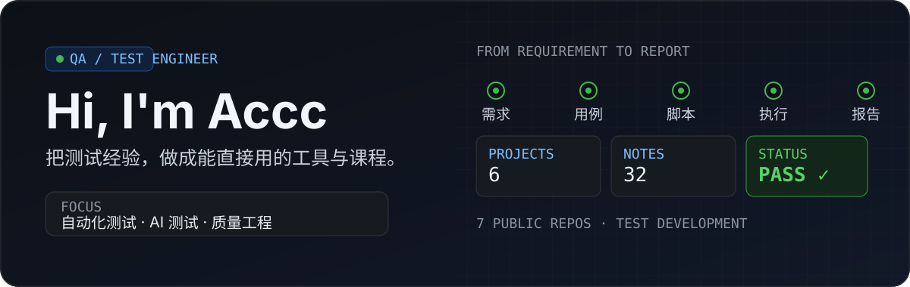

  

**测试工程师 · 自动化测试 · AI 测试**

  
  
  
  
  
  

---

## 🚀 个人项目

| 项目 | 简介 |
|:-----|:-----|
| **📚 [TestDev_Notes](https://github.com/ruhedanghaoyigexuesheng/TestDev_Notes)** `HTML` · `Python` [在线阅读 ↗](https://ruhedanghaoyigexuesheng.github.io/TestDev_Notes/) | 32 篇测试开发笔记，从一个命令到 AI 测试，可直接在浏览器里学 |
| **🤖 [autotest-skills](https://github.com/ruhedanghaoyigexuesheng/autotest-skills)** `Python` · `Skills` | 7 个自动化测试 Skill，串起需求 → 用例 → 脚本 → 报告全流程 |
| **🎓 [llm-testing-course](https://github.com/ruhedanghaoyigexuesheng/llm-testing-course)** `HTML` · `CSS` · `JS` | 大模型测试课程站点，覆盖功能 / 性能 / 安全、评测体系与 Agent / MCP 专项 |
| **🧪 [claude-skills-portfolio](https://github.com/ruhedanghaoyigexuesheng/claude-skills-portfolio)** `Claude Skills` | AI 辅助测试工作流：Bug 分析、日志排查、SQL、回归、Prompt 测试 |
| **⚡ [FileForge](https://github.com/ruhedanghaoyigexuesheng/FileForge)** `Electron` · `React` · `TS` | 桌面端测试文件生成工具，一键生成指定大小 / 格式的测试文件 |
| **📝 [claude-code-notes-skill](https://github.com/ruhedanghaoyigexuesheng/claude-code-notes-skill)** `Claude Code` | 给一个代码目录，自动生成先讲原理、再看代码的学习笔记 |

---

## 🧰 技能领域

| 方向 | 工具 / 技术 |
|:-----|:------------|
| 🧪 **自动化测试** | `Pytest` · `Selenium` · `Appium` · `Playwright` |
| 🔌 **接口测试** | `Postman` · `JMeter` · `Requests` |
| 🗄️ **数据库** | `MySQL` · `Redis` |
| ⚙️ **CI / 工程化** | `Git` · `Docker` · `Jenkins` · `GitHub Actions` |
| 🤖 **AI + 测试** | `Claude Code Skills` · `Prompt Engineering` · `大模型评测` |

---

## 📫 联系我

📧 Email：`1658742929@qq.com`

---

  <i>"Stay hungry, stay foolish."</i>

